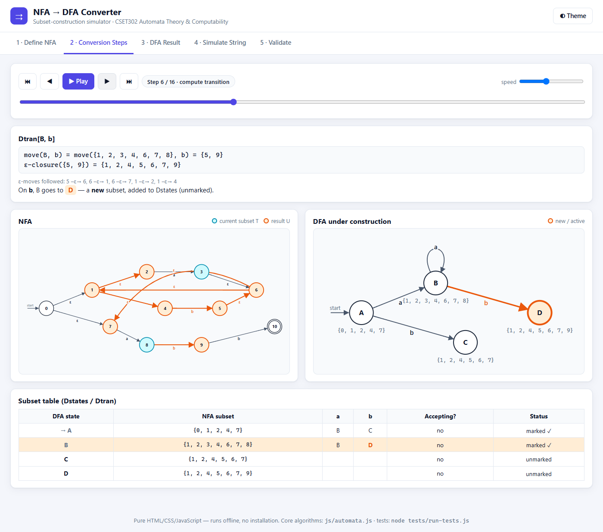

# NFA → DFA Converter

An interactive **subset-construction simulator** for CSET302 — Automata Theory and Computability.
Define any NFA (with or without ε-moves), watch it being converted to an equivalent DFA step by step, simulate strings on both automata, and check that the result is correct.



## Features

| Requirement | How the simulator meets it |
|---|---|
| **Dynamic input** | Type Q, Σ, q₀, F and fill an editable δ table (including an ε column), load one of 6 presets, or import JSON. Live validation with clear error messages. |
| **Correct algorithm** | ε-closure, move and subset construction (Rabin–Scott), optional dead state ∅. Reproduces the textbook DFA for `(a\|b)*abb`. |
| **Step-by-step processing** | Every step is explained: `move(T, a)`, `ε-closure(…)`, and whether the subset is a new DFA state. Play/pause, slider, ⏮ ◀ ▶ ⏭, ← → keys. |
| **Visualisation** | NFA diagram with the current subset highlighted, the DFA growing step by step, the Dstates/Dtran table, the final DFA (diagram + table + formal definition), and string simulation traces. Drag states; export SVG/JSON. |
| **Validation** | Test table with expected vs generated results (NFA, DFA, minimal DFA → PASS/FAIL), an exhaustive check of every string up to length n, and an exact equivalence proof with the shortest counterexample. |
| **Extension** | DFA minimisation (Moore's partition refinement) with every round shown. |

## Run it

No installation, no server, no internet needed:

1. Clone or download this repository.
2. Open **`index.html`** in any modern browser (Chrome, Edge, Firefox).

```bash
git clone https://github.com/Priyanshuraj0909/NFA-to-DFA-Converter.git
cd NFA-to-DFA-Converter
start index.html        # Windows  (macOS: open index.html, Linux: xdg-open index.html)
```

## Run the tests

Requires Node.js (any version ≥ 14), no packages:

```bash
node tests/run-tests.js              # 98 automated tests  (or: npm test)
node tests/generate-test-report.js   # regenerates docs/TEST_CASES.md (expected vs actual)
```

## How to use

1. **Define NFA**: pick a preset and press *Load*, or enter your own automaton. Write several target states as `q0, q1`, and leave a cell empty for ∅. ε can also be typed as `eps` or `λ`.
2. Press **Convert to DFA →**.
3. **Conversion Steps**: press ▶ Play or step through. Cyan = subset T being processed, orange = result U.
4. **DFA Result**: final DFA, transition table, formal definition, *Minimise DFA*.
5. **Simulate String**: type e.g. `abb` and press *Run*, then step through the tape.
6. **Validate**: run the test cases, the exhaustive check and the equivalence proof.

### JSON format
```json
{
  "states": ["q0", "q1", "q2"],
  "alphabet": ["a", "b"],
  "start": "q0",
  "finals": ["q2"],
  "transitions": { "q0": { "a": ["q0", "q1"], "b": ["q0"] }, "q1": { "b": ["q2"] } },
  "tests": [["ab", true], ["ba", false]]
}
```
Use the key `"ε"` (or `"eps"`) for empty moves.

## Project structure

```
index.html                     UI (5 tabs)
css/style.css                  styles, light/dark theme
js/automata.js                 algorithm core — no DOM, shared by browser and tests
js/graph.js                    SVG state-diagram renderer
js/presets.js                  example NFAs + hand-verified expected results
js/app.js                      UI controller
tests/run-tests.js             automated test suite
tests/generate-test-report.js  writes docs/TEST_CASES.md
docs/M1_DESIGN.md              Milestone-I: problem, specification, tool review, architecture, UML, pseudocode, worked example
docs/M2_REPORT.md              Milestone-II: technical report
docs/TEST_CASES.md             test cases with expected vs actual results
```

## Algorithm (subset construction)

```
A ← ε-closure({q₀});  Dstates ← {A} (unmarked)
while some T ∈ Dstates is unmarked:
    mark T
    for each a ∈ Σ:
        U ← ε-closure(move(T, a))
        if U ∉ Dstates: add U (unmarked)
        Dtran[T, a] ← U
F′ ← { T ∈ Dstates : T ∩ F ≠ ∅ }
```

## Documentation
- [Milestone-I design document](docs/M1_DESIGN.md)
- [Milestone-II technical report](docs/M2_REPORT.md)
- [Test cases (expected vs actual)](docs/TEST_CASES.md)
