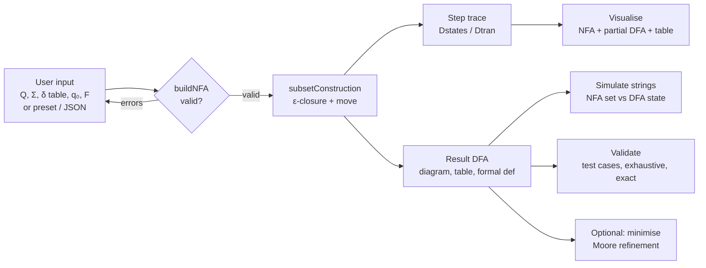
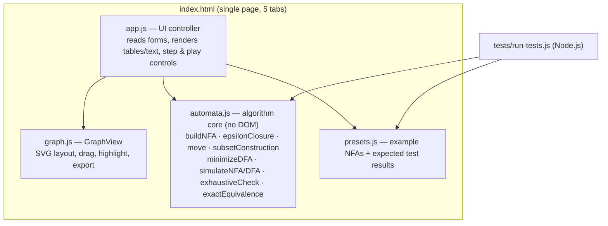
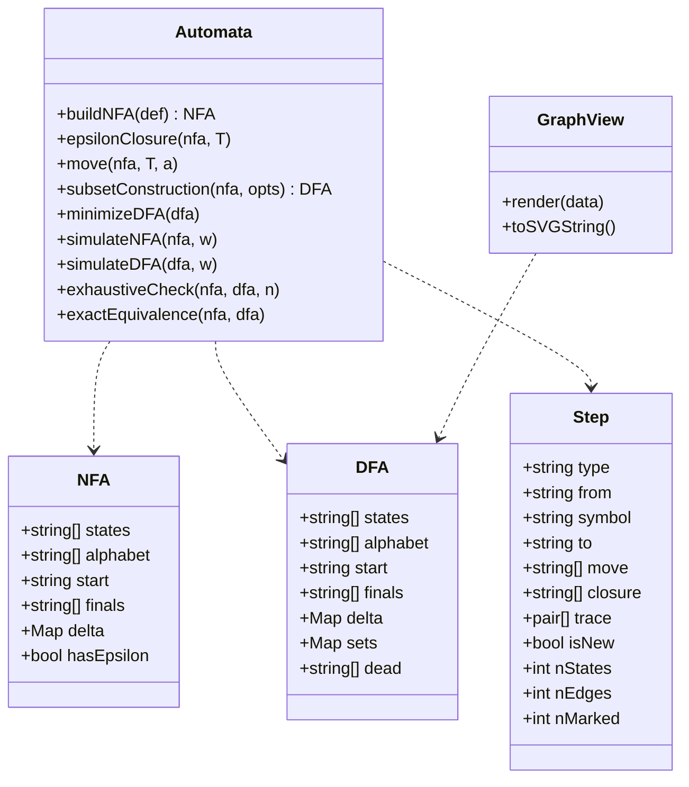

# Milestone-I — Simulator Design Review

**Course:** CSET302 — Automata Theory and Computability
**Project:** NFA → DFA Converter (Subset-Construction Simulator)

---

## 1. Problem Definition & Automata Specification

### 1.1 Problem statement
A **non-deterministic finite automaton (NFA)** can be in several states at once and may change state without reading input (ε-moves). This makes NFAs easy to design but hard to execute directly. A **deterministic finite automaton (DFA)** has exactly one next state for every (state, symbol) pair, so it is trivial to run in software and hardware — lexical analysers, pattern matchers and protocol checkers all run DFAs.

Rabin & Scott (1959) proved that every NFA has an equivalent DFA, built by the **subset (powerset) construction**. Students usually perform this construction by hand, where it is slow and error-prone: one missed ε-move gives a wrong DFA, and it is hard to check the answer.

**This project builds an interactive simulator that converts any user-defined ε-NFA into an equivalent DFA, shows every intermediate step, visualises both automata, runs strings on them, and validates that the two accept the same language.**

### 1.2 Objectives
1. Accept a **user-defined** ε-NFA (states, alphabet, transition function, start state, final states) through a form/table or JSON.
2. **Validate** the definition and report clear errors (unknown states/symbols, missing start state, etc.).
3. Implement the **ε-closure**, **move** and **subset-construction** algorithms correctly.
4. Show the conversion **step by step**: which subset is being processed, `move`, `ε-closure`, and whether a new DFA state is created.
5. **Visualise** the NFA, the DFA as it is being built, and the subset (Dstates/Dtran) table.
6. **Simulate** input strings on the NFA (set of active states) and the DFA (single active state).
7. **Validate** the result: user test cases (expected vs generated), an exhaustive check over all short strings, and an exact equivalence check.
8. *(Extension)* Minimise the generated DFA with Moore's partition-refinement algorithm.

### 1.3 Inputs and outputs

| | Description |
|---|---|
| **Input** | ε-NFA N = (Q, Σ, δ, q₀, F); optional test strings with expected accept/reject; option to include the dead state |
| **Processing** | Validation → ε-closure / move → subset construction (with trace) → (optional) minimisation |
| **Output** | DFA D = (Q′, Σ, δ′, q₀′, F′) as a diagram, transition table and formal definition; step-by-step trace; simulation traces; validation report; JSON/SVG export |

### 1.4 Formal model

**Input — ε-NFA** N = (Q, Σ, δ, q₀, F)
- Q — finite set of states
- Σ — finite input alphabet (ε ∉ Σ)
- δ : Q × (Σ ∪ {ε}) → P(Q) — transition function into the *power set* of Q
- q₀ ∈ Q — start state
- F ⊆ Q — set of final (accepting) states

**Definitions used by the algorithm**
- ε-closure(T) = the smallest set containing T such that if p ∈ ε-closure(T) and q ∈ δ(p, ε) then q ∈ ε-closure(T).
- move(T, a) = ⋃ { δ(p, a) : p ∈ T }.

**Output — DFA** D = (Q′, Σ, δ′, q₀′, F′)
- Q′ ⊆ P(Q) — only the subsets reachable from q₀′ (at most 2^|Q|)
- q₀′ = ε-closure({q₀})
- δ′(T, a) = ε-closure(move(T, a))
- F′ = { T ∈ Q′ : T ∩ F ≠ ∅ }

**Correctness property (validated by the simulator):** for every w ∈ Σ*, δ̂′(q₀′, w) = ε-closure-extended δ̂(q₀, w), hence **L(D) = L(N)**.

---

## 2. Existing Tools & Feasibility

| Tool | Type | NFA → DFA? | Strengths | Limitations relevant to this project |
|---|---|---|---|---|
| **JFLAP** (Duke Univ.) | Java desktop app | Yes | Widely used in teaching; draws NFAs, DFAs, PDAs, TMs | Needs a Java runtime; dated UI; the conversion is done interactively by the student rather than explained with ε-closure/move text; no built-in equivalence proof |
| **Automata Tutor v3** | Web platform | Exercises | Auto-grades student constructions | Requires an account/course setup; it is an assessment tool, not a step-by-step visualiser |
| **FSM Simulator** (Ivan Zuzak, "noam") | Web app | Regex → automata | Clean animation of string simulation | Input is a regular expression; no editable transition table and no subset-construction trace |
| **Automaton Simulator** (automatonsimulator.com) | Web app | No | Draw and test DFA/NFA/PDA | Simulation only, no conversion |
| **Online regex/automata toolboxes** (e.g. CyberZHG's toolbox) | Web page | Regex → NFA → DFA | Shows final tables quickly | Starts from a regex, not a user-drawn NFA; shows only the final result, not each step |

**Gap identified:** there is no lightweight tool that (a) takes an arbitrary user-defined ε-NFA, (b) explains every subset-construction step with ε-closure/move values, (c) animates the DFA growing, and (d) *proves* the result equivalent — all without installation.

### Feasibility
- **Technical:** the algorithms are polynomial in the size of the generated DFA; reachable subsets are usually small. A state-limit guard (1024 DFA states) protects against the 2ⁿ worst case.
- **Platform:** plain HTML/CSS/JavaScript runs in any modern browser, offline, with no installation or server — ideal for a live classroom demo.
- **Testing:** the algorithm module is DOM-free, so it can be unit-tested with Node.js without any extra libraries.
- **Effort:** core algorithms ≈ 500 lines; UI ≈ 700 lines; renderer ≈ 300 lines — achievable within the milestone schedule.

---

## 3. Simulator Design & Methodology

### 3.1 Processing pipeline
`User Input → Validation → Algorithm → Step-by-Step Processing / Visualization → Result → Validation`



### 3.2 Architecture (modules)



Design decisions:
- **Separation of concerns:** all theory lives in `automata.js`, which has no DOM access. The same file is loaded by the browser and by the Node test-suite, so what we test is exactly what we demo.
- **Trace-producing algorithms:** `subsetConstruction` records every step (`start`, `mark`, `transition`, `done`) together with how many DFA states/edges exist at that moment. The UI can therefore jump to *any* step instantly (slider, previous/next, play).
- **No external libraries:** diagrams are drawn by a small custom SVG renderer, so the tool works offline.

### 3.3 UML — main data structures and functions



### 3.4 UI wireframe

```
┌──────────────────────────────────────────────────────────────────────────┐
│ ⇉ NFA → DFA Converter                                          ◐ Theme   │
├──────────────────────────────────────────────────────────────────────────┤
│ 1·Define NFA │ 2·Conversion Steps │ 3·DFA Result │ 4·Simulate │ 5·Validate│
├───────────────────────────────────┬──────────────────────────────────────┤
│ Load example [ ▼ presets ] [Load] │  NFA state diagram (drag to move)    │
│ Q  [q0, q1, q2]   Σ [a, b]        │   →(q0)─a→(q1)─b→((q2))              │
│ q₀ [q0]           F [q2]          │                                      │
│ δ table:                          │  ✓ Valid NFA |Q|=3 …  / ✗ errors     │
│   δ     │ a      │ b   │ ε        │  [x] include dead state ∅            │
│  → q0   │ q0,q1  │ q0  │          │  [      Convert to DFA →      ]      │
│    q1   │        │ q2  │          │                                      │
│  * q2   │        │     │          │                                      │
│ JSON import / export              │                                      │
└───────────────────────────────────┴──────────────────────────────────────┘
 Tab 2: [⏮][◀][▶ Play][▶][⏭] Step 7/16 ───●────────   explanation box
        NFA (T and U highlighted) │ DFA under construction │ subset table
 Tab 3: stats · DFA diagram · transition table · formal definition · minimise
 Tab 4: input string → tape, step controls, NFA active-set trace │ DFA trace
 Tab 5: test table (input, expected, NFA, DFA, Min-DFA, PASS/FAIL),
        exhaustive check (length ≤ n), exact equivalence proof
```

---

## 4. Algorithm Selection & Correctness

### 4.1 ε-closure (iterative DFS)
```
function EPSILON-CLOSURE(T):
    closure ← T ; stack ← all states of T
    while stack not empty:
        p ← pop(stack)
        for each q in δ(p, ε):
            if q ∉ closure:
                closure ← closure ∪ {q}; push(stack, q)
    return closure
```
The `q ∉ closure` test guarantees termination even with ε-cycles; each state is pushed at most once → O(|Q| + |δ_ε|).

### 4.2 move
```
function MOVE(T, a):
    return ⋃ over p ∈ T of δ(p, a)
```

### 4.3 Subset construction
```
function SUBSET-CONSTRUCTION(N):
    A ← EPSILON-CLOSURE({q₀})
    Dstates ← [A] (unmarked)
    while there is an unmarked T in Dstates:
        mark T
        for each a ∈ Σ:
            U ← EPSILON-CLOSURE(MOVE(T, a))
            if U ∉ Dstates: add U to Dstates as unmarked      (U = ∅ → dead state)
            Dtran[T, a] ← U
    F′ ← { T ∈ Dstates : T ∩ F ≠ ∅ }
    return (Dstates, Σ, Dtran, A, F′)
```
Subsets are stored in canonical (sorted) form and looked up in a hash map, so "U ∉ Dstates" costs O(|U|).
**Complexity:** O(|Q′| · |Σ| · |Q|²) in the worst case, where |Q′| ≤ 2^|Q|.

**Why it is correct:** by induction on |w|, after reading w the DFA is in the subset that equals exactly the set of NFA states reachable on w (including ε-moves). The DFA accepts iff that set contains a final state — which is exactly the NFA acceptance condition. Hence L(D) = L(N).

### 4.4 Validation algorithms
- **Exhaustive check:** run every string over Σ with length ≤ n on both automata and compare.
- **Exact equivalence:** BFS over reachable pairs (NFA subset, DFA state); the languages are equal iff no reachable pair disagrees on acceptance. BFS returns the *shortest* counterexample if one exists.

### 4.5 Manually validated example

**NFA** for "strings over {a, b} that end in `ab`":
N = ({q0, q1, q2}, {a, b}, δ, q0, {q2})

| δ | a | b |
|---|---|---|
| → q0 | {q0, q1} | {q0} |
| q1 | ∅ | {q2} |
| * q2 | ∅ | ∅ |

**Hand computation** (no ε-moves, so ε-closure(T) = T):

| Step | Computation | Result |
|---|---|---|
| 1 | A = ε-closure({q0}) | A = {q0} (new) |
| 2 | move(A, a) = {q0, q1} | **B** = {q0, q1} (new) |
| 3 | move(A, b) = {q0} | A |
| 4 | move(B, a) = {q0, q1} ∪ ∅ = {q0, q1} | B |
| 5 | move(B, b) = {q0} ∪ {q2} = {q0, q2} | **C** = {q0, q2} (new) |
| 6 | move(C, a) = {q0, q1} ∪ ∅ | B |
| 7 | move(C, b) = {q0} ∪ ∅ | A |
| 8 | no unmarked states remain; F′ = subsets containing q2 | F′ = {C} |

**Resulting DFA**

| DFA state | NFA subset | a | b |
|---|---|---|---|
| → A | {q0} | B | A |
| B | {q0, q1} | B | C |
| * C | {q0, q2} | B | A |

**Check with a string:** `abab`: A –a→ B –b→ C –a→ B –b→ C ∈ F′ → **accepted** ✓ (it ends in "ab").
`abb`: A –a→ B –b→ C –b→ A ∉ F′ → **rejected** ✓.

**Simulator output** for the same NFA (preset *"Strings ending in ab"*) produces exactly this table, and the validator reports `L(NFA) = L(DFA)` — see [TEST_CASES.md](TEST_CASES.md).

A second, larger example — Thompson's 11-state ε-NFA for `(a|b)*abb` — reproduces the textbook DFA (Aho, Lam, Sethi & Ullman, *Compilers*, 2nd ed., Example 3.21): A = {0,1,2,4,7}, B = {1,2,3,4,6,7,8}, C = {1,2,4,5,6,7}, D = {1,2,4,5,6,7,9}, E = {1,2,4,5,6,7,10}. This is checked automatically by `tests/run-tests.js`.

---

## 5. Preliminary prototype
A working prototype is already implemented (`index.html`) — open it in a browser. See the [README](../README.md) for usage.
