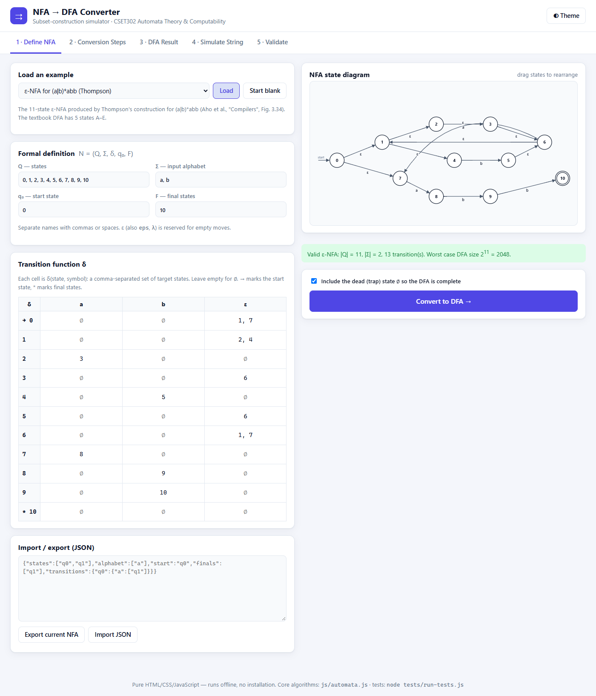
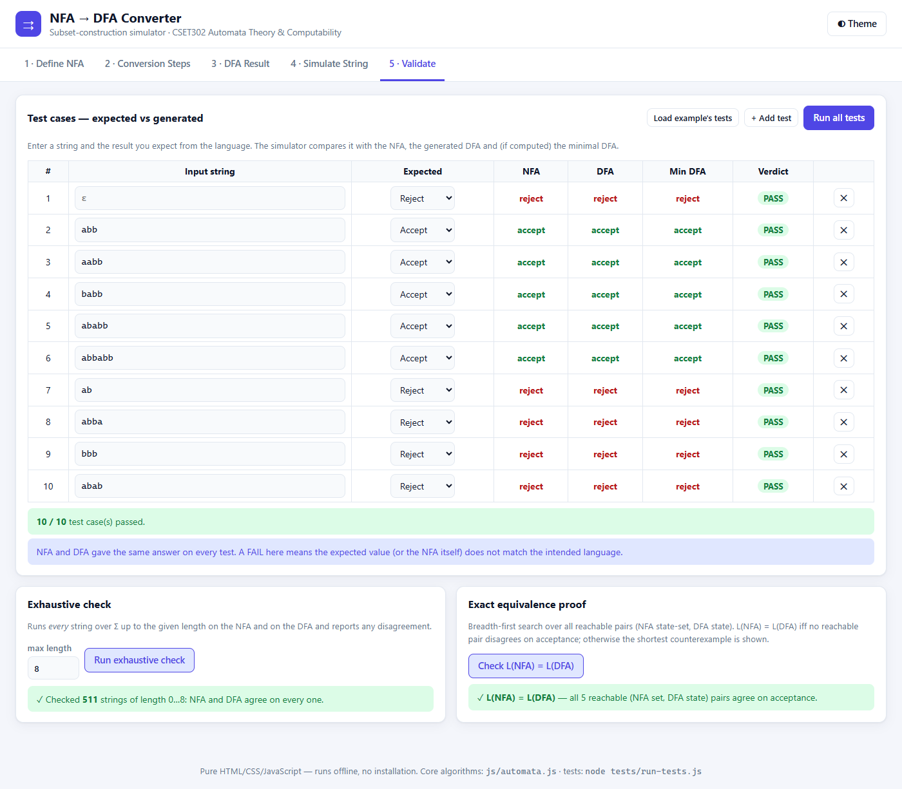
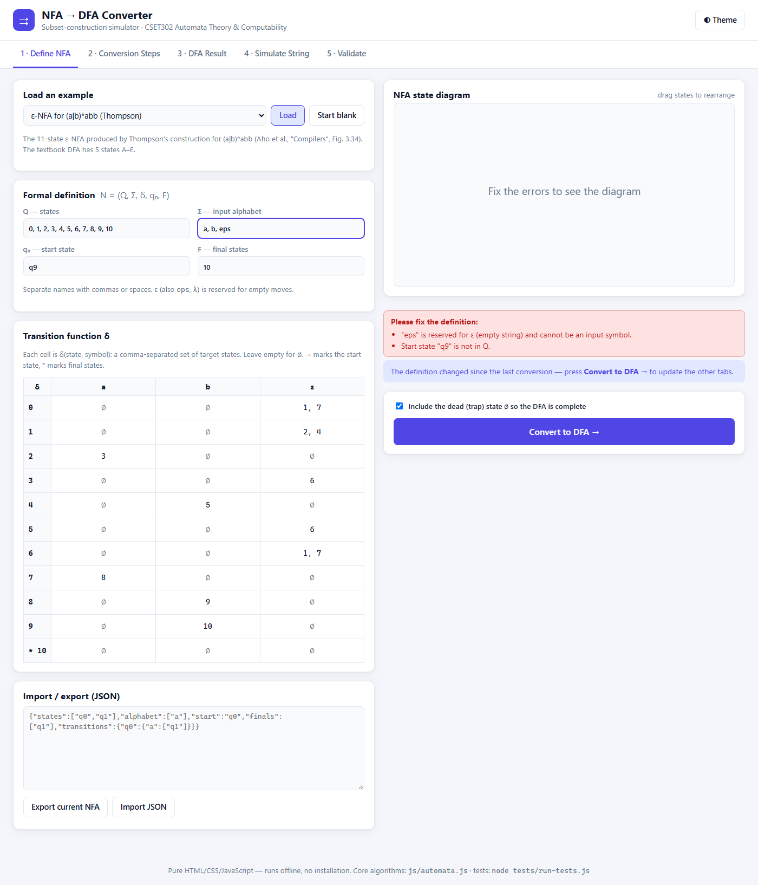

# Milestone-II — Technical Report

**Course:** CSET302 — Automata Theory and Computability
**Project:** NFA → DFA Converter (Subset-Construction Simulator)
**Repository:** https://github.com/Priyanshuraj0909/NFA-to-DFA-Converter

---

## Abstract
We built a browser-based simulator that converts a user-defined non-deterministic finite automaton (with or without ε-moves) into an equivalent deterministic finite automaton with the subset construction. The simulator explains every step (ε-closure, move, new or existing state), draws the NFA and the growing DFA, runs strings on both machines side by side, and validates the result three ways: user test cases (expected vs generated), an exhaustive check of all short strings, and an exact equivalence check that returns the shortest counterexample when the languages differ. As an extension, it also minimises the DFA with Moore's partition refinement. All 98 automated tests and all 48 documented test cases pass.

---

## 1. Introduction
NFAs are the natural target when building automata from regular expressions (Thompson's construction), but they cannot be executed directly in one pass because they may be in many states at once. Converting them to DFAs is a core result of automata theory (Rabin–Scott theorem) and a standard step in lexer generators such as `lex`/`flex`. Doing this by hand is slow and error-prone, so a simulator that shows each step and checks the answer is a useful teaching tool.

## 2. Theory

### 2.1 ε-NFA
N = (Q, Σ, δ, q₀, F) with δ : Q × (Σ ∪ {ε}) → P(Q). N accepts w if some sequence of moves that reads w (with any number of ε-moves in between) ends in a state of F.

### 2.2 DFA
D = (Q′, Σ, δ′, q₀′, F′) with δ′ : Q′ × Σ → Q′, a single next state for every pair.

### 2.3 Subset construction (Rabin–Scott)
- q₀′ = ε-closure({q₀})
- δ′(T, a) = ε-closure(move(T, a))
- F′ = { T : T ∩ F ≠ ∅ }

Only subsets reachable from q₀′ are generated. The empty subset ∅ is a **dead (trap) state**: it loops to itself on every symbol and never accepts.

**Theorem.** L(D) = L(N).
*Proof sketch.* By induction on |w|: δ̂′(q₀′, w) equals the set S(w) of NFA states reachable from q₀ by reading w (with ε-moves). Base: S(ε) = ε-closure({q₀}) = q₀′. Step: S(wa) = ε-closure(move(S(w), a)) = δ′(δ̂′(q₀′, w), a). D accepts w ⇔ S(w) ∩ F ≠ ∅ ⇔ N accepts w. ∎

**Blow-up.** |Q′| ≤ 2^|Q|, and the bound is tight: the 4-state NFA for "third symbol from the end is 1" needs 2³ = 8 DFA states (included as a preset).

### 2.4 DFA minimisation (extension)
Moore's algorithm starts with the partition P₀ = {F′, Q′ − F′} and repeatedly splits groups: two states stay together only if, for every symbol, their successors lie in the same group. When the partition stops changing, each group becomes one state of the minimal DFA.

---

## 3. Methodology
1. **Requirements** taken from the course's minimum technical standard: dynamic input → algorithm → step-by-step processing/visualisation → result → validation.
2. **Design** (Milestone-I, see [M1_DESIGN.md](M1_DESIGN.md)): formal specification, review of existing tools, architecture, UML, wireframe, pseudocode, one hand-solved example.
3. **Implementation** in plain JavaScript with a strict split between the algorithm core (no DOM) and the UI.
4. **Verification:** hand-computed examples (including the textbook (a|b)*abb DFA), unit tests, randomised testing against an independent reference simulator, and in-app equivalence proofs.

---

## 4. Architecture & Implementation

```
index.html          single page with 5 tabs
css/style.css       layout, light/dark themes
js/automata.js      ALGORITHM CORE (pure functions, runs in browser and Node.js)
js/graph.js         SVG state-diagram renderer (auto-layout, drag, highlight, export)
js/presets.js       example NFAs with hand-verified expected results
js/app.js           UI controller: forms, tables, step player, simulator, validator
tests/run-tests.js  98 automated tests (node tests/run-tests.js)
tests/generate-test-report.js  regenerates docs/TEST_CASES.md
```

### 4.1 Core functions (`js/automata.js`)

| Function | Purpose | Notes |
|---|---|---|
| `buildNFA(def)` | Parse and validate user input | Accepts object or triple-list transitions; ε aliases `eps`, `λ`, `^`; reports errors (unknown state/symbol/start, empty Q or Σ) and warnings (F = ∅, unreachable states) |
| `epsilonClosure(nfa, T)` | ε-closure with the ε-edges used | Iterative DFS with a visited set → terminates on ε-cycles |
| `move(nfa, T, a)` | Union of a-successors | Result sorted in declaration order (canonical form) |
| `subsetConstruction(nfa, opts)` | NFA → DFA | Records `start`/`mark`/`transition`/`done` steps with snapshot counts; option to omit the dead state; guard at 1024 states |
| `minimizeDFA(dfa)` | Moore partition refinement | Removes unreachable states, completes with a trap state, returns every round |
| `tokenize(Σ, input)` | Split input into symbols | Supports multi-character symbols separated by spaces; rejects symbols ∉ Σ |
| `simulateNFA`, `simulateDFA` | Run a string | Full trace of active set / active state |
| `exhaustiveCheck(nfa, dfa, n)` | Compare on all strings ≤ n | Incremental DFS, capped at 200 000 strings |
| `exactEquivalence(nfa, dfa)` | Prove L(N) = L(D) | BFS over (NFA subset, DFA state) pairs; shortest counterexample |

### 4.2 Step-by-step engine
Every step stores `nStates`, `nEdges` and `nMarked` — how much of the DFA exists *after* that step. To show step k, the UI simply draws the first `nStates` DFA states and first `nEdges` edges, and highlights the subset T (cyan) and result U (orange) on the NFA. Because the full DFA is known, node positions are computed once from the final DFA, so states do not jump around while the DFA grows.

### 4.3 Visualisation (`js/graph.js`)
- Layered layout: column = BFS distance from the start state; nodes in a column are spread vertically and staggered.
- Parallel edges are merged into one arrow with a combined label (e.g. `a, b`); opposite edges are curved apart; an edge that would pass through another node is bent around it; self-loops are drawn above the node.
- Final states are double circles; the dead state is dashed; each DFA state shows its NFA subset underneath.
- States can be dragged; diagrams can be exported as SVG.

### 4.4 User interface
| Tab | What the user does / sees |
|---|---|
| 1 · Define NFA | Load a preset or type Q, Σ, q₀, F; fill the δ table (one cell per state × symbol, plus ε); live validation messages and live NFA diagram; JSON import/export |
| 2 · Conversion Steps | ⏮ ◀ ▶ ⏭, Play with speed control, slider, ←/→ keys; explanation text with the `move`/`ε-closure` formulas; NFA with T and U highlighted; DFA under construction; Dstates/Dtran table |
| 3 · DFA Result | Statistics (|Q|, |Q′|, 2ⁿ bound, …), DFA diagram, transition table, formal definition; *Minimise* button showing partition rounds and the minimal DFA |
| 4 · Simulate String | Input tape, step controls, NFA active-set trace and DFA state trace side by side, verdicts with reasons |
| 5 · Validate | Editable test table (input, expected) → NFA / DFA / Min-DFA results and PASS/FAIL; exhaustive check; exact equivalence proof |

---

## 5. Testing & Results

### 5.1 Automated suite — `node tests/run-tests.js`
**98 passed, 0 failed.** The suite covers:
1. Every preset: valid definition, expected DFA size, every test string on both NFA and DFA, exact equivalence, and an exhaustive check up to length 8.
2. The textbook example (a|b)*abb: ε-closure({0}), `move(A, a)`, all five subsets A–E, the full Dtran table, F′ = {E}, and the minimal DFA (A and C merged).
3. Edge cases (see 5.3).
4. **Randomised testing:** 300 random ε-NFAs (1–5 states, random ε-moves) → the generated DFA is proved equivalent each time, and on 4 500 random strings it agrees with an *independent* backtracking NFA simulator that does not use subset construction.

### 5.2 Documented test cases
[TEST_CASES.md](TEST_CASES.md) (generated from real runs) lists **48 test cases with expected and actual results — 48/48 pass**.

| Example | NFA states | DFA states | Min-DFA | Shows |
|---|---|---|---|---|
| Strings ending in "ab" | 3 | 3 | 3 | basic non-determinism |
| ε-NFA for (a\|b)*abb | 11 | 5 | 4 | ε-closures, textbook result, minimisation |
| Third symbol from end is 1 | 4 | 8 | 8 | exponential blow-up (2³) |
| a*b* with ε-move | 2 | 3 | 3 | dead state ∅ |
| ε-cycle | 3 | 1 | 1 | closure termination on cycles |
| Multi-character symbols | 5 | 6 | 6 | tokens such as `if id else id` |

### 5.3 Edge cases handled
- Empty or incomplete definition → clear error list; Convert is refused.
- Start/final/target state not in Q, symbol not in Σ, ε used as a symbol → errors.
- F = ∅ → warning; DFA has no accepting state.
- Unreachable NFA states → warning; they never appear in a DFA subset.
- Start state final → ε accepted.
- Missing transitions → dead state ∅ (or undefined transition if the user disables it; the simulator then reports "stuck → reject").
- ε-cycles → closure terminates.
- Input with symbols outside Σ → rejected before simulation with the offending symbols listed.
- Very large DFAs → stopped at 1024 states with a message.
- A deliberately wrong DFA → the equivalence checker reports the shortest counterexample.

### 5.4 Screenshots
| | |
|---|---|
|  |  |
|  |  |
|  |  |

---

## 6. Limitations & Future Work
- Worst-case exponential growth is inherent to the problem; the tool caps the DFA at 1024 states.
- Diagram layout is automatic but simple; very dense automata may need manual dragging.
- Possible extensions: regular expression → ε-NFA (Thompson) input, DFA → regular expression, saving and sharing automata by URL, export to PNG/LaTeX (TikZ).

## 7. Conclusion
The simulator meets every item of the minimum technical standard: **dynamic input** (form, table, JSON, presets), a **correct algorithm** (textbook results reproduced, 300 random NFAs proved equivalent), **step-by-step processing** (every ε-closure and move explained), **visualisation** (NFA, growing DFA, subset table, simulation traces) and **validation** (expected-vs-generated test table, exhaustive check, exact equivalence). It runs in any browser with no installation, which makes it practical for live demonstrations and for students checking their own hand conversions.

---

## 8. Individual Contribution

| Member | Roll No. | Contribution |
|---|---|---|
| _Name_ | _Roll_ | _e.g. algorithm core (`automata.js`), ε-closure & subset construction, unit tests_ |
| _Name_ | _Roll_ | _e.g. SVG visualisation (`graph.js`), step-by-step player_ |
| _Name_ | _Roll_ | _e.g. UI & input validation (`app.js`, `index.html`, `style.css`)_ |
| _Name_ | _Roll_ | _e.g. validation tab, test cases, report & presentation_ |

## References
1. M. O. Rabin and D. Scott, "Finite Automata and Their Decision Problems," *IBM Journal of Research and Development*, 3(2), 1959.
2. J. E. Hopcroft, R. Motwani, J. D. Ullman, *Introduction to Automata Theory, Languages, and Computation*, 3rd ed., Pearson.
3. A. V. Aho, M. S. Lam, R. Sethi, J. D. Ullman, *Compilers: Principles, Techniques, and Tools*, 2nd ed., §3.7 (Algorithm 3.20, Example 3.21).
4. M. Sipser, *Introduction to the Theory of Computation*, 3rd ed., §1.2.
5. E. F. Moore, "Gedanken-experiments on Sequential Machines," *Automata Studies*, Princeton, 1956.
